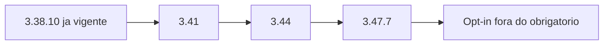

# Catálogo de verificação Flutter 3.38.10 para 3.47.7

Documento de referência para agentes. Esta fase não avalia aplicativo, `pubspec`, plugin instalado nem design system local. Cada registro descreve o que procurar quando uma fase posterior receber um repositório alvo.

Fonte principal: [Breaking changes and migration guides](https://docs.flutter.dev/release/breaking-changes), página alinhada ao stable 3.47 (atualização de 24 out 2026), mais os anúncios de 3.41, 3.44 e 3.47. O índice oficial não lista cada `@Deprecated` do changelog. Este catálogo cobre os guias do delta, as depreciações anunciadas no blog da 3.44 e as mudanças de acessibilidade descritas nos anúncios. Não é um diff commit a commit do framework.

## Recorte

- Origem: Flutter **3.38.10**, Dart **3.10**. Os guias “Released in Flutter 3.38” já estão nesse SDK.
- Destino: Flutter **3.47.7** (hotfix de 8 out 2026 sobre a 3.47.0 de 12 ago 2026), Dart **3.13.0**.
- O hotfix 3.47.7 corrige frames de acessibilidade do `OverlayPortal` no iOS e o foco do VoiceOver em `ReorderableListView`. Não adiciona breaking change novo. Parar em 3.47.0 deixa esses dois defeitos de acessibilidade.
- Delta obrigatório: 3.41, 3.44 e 3.47.
- Dívida já vigente em 3.38 entra em seção própria. Widgets customizados ainda podem chamar a API antiga.
- Em 3.47, `package:material_ui` e `package:cupertino_ui` são opt-in. `package:flutter/material.dart` e `package:flutter/cupertino.dart` continuam válidos. A depreciação formal foi adiada para o stable seguinte ao anúncio de novembro de 2026.
- Vários guias oficiais já foram reescritos com imports `package:material_ui` e `package:cupertino_ui`. Na 3.47.7, a migração equivalente usa os imports do framework, a menos que o time opte pelos pacotes novos.
- A 3.47.8 bloqueia chaves comprometidas da CA eMudhra. Isso não muda a lista de breaking changes. Este catálogo permanece ancorado na 3.47.7.

## Como ler um registro

- **id:** chave estável para agentes.
- **release:** stable em que o efeito entra.
- **tipo:** `comportamento`, `deprecacao`, `remocao`, `compilacao`, `plataforma`, `teste`, `correcao`, `adicao`.
- **severidade:** `alta`, `media`, `baixa`.
- **obrigatorio_no_salto:** `sim` entra no delta 3.41–3.47.7. `nao` é dívida 3.38 ou item ainda fora do stable.
- **dart_fix:** `sim` quando o guia declara migração automática. `nao` quando o guia declara que `dart fix` não cobre, ou quando não há fix publicado.
- **contagem:** `unica_no_ds` conta uma vez no design system compartilhado. `por_ocorrencia` conta cada chamada. `plataforma` conta uma vez no projeto nativo ou no shader.
- **simbolos:** strings para busca textual na fase posterior. Não executar essa busca nesta fase.

Regra de contagem: widget customizado que só lê `Theme`, `ColorScheme` ou `TextStyle` do pacote de tema herda o efeito do registro `unica_no_ds`. Esse widget não gera um achado novo.

## Índice

| id | release | severidade | assunto | contagem |
| --- | --- | --- | --- | --- |
| A11Y-001 | 3.47 | alta | `header` vira no-op; usar `headingLevel` | por_ocorrencia |
| A11Y-002 | 3.41 | media | `containsSemantics` para `isSemantics` | por_ocorrencia |
| A11Y-003 | 3.47 | media | `isSemantics` passa a exigir `role` e filhos | por_ocorrencia |
| A11Y-004 | 3.38 | alta | `focusable` para `isFocused` tristate | por_ocorrencia |
| A11Y-005 | 3.41 | baixa | indicadores anunciam progresso | unica_no_ds |
| A11Y-006 | 3.41 | media | link sem URL vira botão no Android | por_ocorrencia |
| A11Y-007 | 3.41 | baixa | cache de semântica de tabela | unica_no_ds |
| A11Y-008 | 3.41 | baixa | semântica de item de menu | unica_no_ds |
| A11Y-009 | 3.41 | media | semântica de `OverlayPortal` | por_ocorrencia |
| A11Y-010 | 3.44 | baixa | movimento acessível no iOS | unica_no_ds |
| A11Y-011 | 3.44 | baixa | valor semântico em porcentagem | por_ocorrencia |
| A11Y-012 | 3.44 | media | geometria semântica do `Slider` | unica_no_ds |
| A11Y-013 | 3.44 | media | elementos invisíveis antes do scroll | unica_no_ds |
| A11Y-014 | 3.44 | baixa | `prefers-reduced-motion` e `aria-description` na web | unica_no_ds |
| A11Y-015 | 3.47.7 | alta | frame do `OverlayPortal` no iOS | por_ocorrencia |
| A11Y-016 | 3.47.7 | alta | VoiceOver em `ReorderableListView` | por_ocorrencia |
| API-001 | 3.41 | media | `findChildIndexCallback` | por_ocorrencia |
| API-002 | 3.41 | media | `FontWeight.index` e eixo `wght` | unica_no_ds |
| API-003 | 3.44 | alta | `onReorder` para `onReorderItem` | por_ocorrencia |
| API-004 | 3.44 | media | `cacheExtent` para `scrollCacheExtent` | por_ocorrencia |
| API-005 | 3.44 | media | `TextInputConnection.setStyle` | por_ocorrencia |
| API-006 | 3.44 | media | sheet Cupertino `scrollableBuilder` | por_ocorrencia |
| API-007 | 3.44 | alta | `IconData` final | por_ocorrencia |
| API-008 | 3.47 | alta | remoção de `describeEnum` | por_ocorrencia |
| API-009 | 3.44 | baixa | flag web e template `plugin_ffi` | plataforma |
| DS-001 | 3.41 | media | tokens `on*Container` | unica_no_ds |
| DS-002 | 3.44 | media | `CupertinoPageTransitionsBuilder` | unica_no_ds |
| DS-003 | 3.44 | media | assertion de cor do `ListTile` | unica_no_ds |
| DS-004 | 3.44 | baixa | Material e Cupertino congelados | unica_no_ds |
| DS-005 | 3.44 | media | ordem de fechamento do `RawMenuAnchor` | por_ocorrencia |
| DS-006 | 3.47 | baixa | pacotes `material_ui` e `cupertino_ui` | unica_no_ds |
| PLAT-001 | 3.44 / 3.47 | alta | Kotlin embutido e AGP 9 | plataforma |
| PLAT-002 | 3.44 | media | `abiFilters` | plataforma |
| PLAT-003 | 3.44 | media | orientação no Android 17 | plataforma |
| PLAT-004 | 3.47 | alta | iOS 15 e macOS 12 | plataforma |
| PLAT-005 | 3.38 / 3.41 / 3.47 | alta | `UIScene` | plataforma |
| PLAT-006 | 3.44 | alta | SwiftPM no lugar de CocoaPods | plataforma |
| PLAT-007 | 3.41 | baixa | threads fundidas no Linux | plataforma |
| PLAT-008 | 3.47 | baixa | Impeller default no desktop | plataforma |
| PLAT-009 | 3.44 / 3.47 | baixa | Mac Intel | plataforma |
| PLAT-010 | 3.47 | media | OpenGL ES top-down | plataforma |
| BASE-001 | 3.38 | media | `OverlayPortal.targetsRootOverlay` | por_ocorrencia |
| BASE-002 | 3.38 | media | `SnackBar` com ação | unica_no_ds |
| BASE-003 | 3.38 | media | predictive back default no Android | unica_no_ds |
| BASE-004 | 3.38 | baixa | `CupertinoDynamicColor` wide gamut | unica_no_ds |

`SliverSemantics` já existe em 3.38. Não é breaking change deste salto.

Nenhum widget Material ou Cupertino foi removido neste intervalo. O que muda é parâmetro, classe final, função removida ou comportamento de semântica.

## Acessibilidade

### A11Y-001 — `header` deixa de marcar cabeçalho no iOS e no Android

- **id:** A11Y-001
- **release:** 3.47
- **tipo:** comportamento
- **severidade:** alta
- **obrigatorio_no_salto:** sim
- **dart_fix:** nao
- **contagem:** por_ocorrencia
- **simbolos:** `header:`, `SemanticsProperties(`, `headingLevel:`
- **widgets:** `Semantics`, `SemanticsProperties`, títulos e seções de widgets customizados
- **design_system_compartilhado:** cada componente de título do design system que passa `header: true` é um achado. Telas que só usam esse componente não repetem o achado.
- **risco:** TalkBack e VoiceOver deixam de tratar o nó como cabeçalho. A API continua compilando. Na web, `headingLevel` 1–6 ainda mapeia para `h1`–`h6`.
- **efeito:** `header: true` vira no-op no iOS e no Android. `headingLevel` maior que 0 mapeia para `View.setHeading(true)` no Android e para `UIAccessibilityTraitHeader` no iOS. No iOS 13 ou superior, também mapeia para `accessibilityHeadingLevel`.
- **mitigacao:** trocar `Semantics(header: true, ...)` e `SemanticsProperties(header: true)` por `headingLevel: 1` ou outro inteiro maior que 0. Escolher o nível de acordo com a hierarquia real da tela, porque a web distingue os números.
- **fonte:** https://docs.flutter.dev/release/breaking-changes/semantics-header-heading-level

### A11Y-002 — `containsSemantics` passa a ser `isSemantics`

- **id:** A11Y-002
- **release:** 3.41
- **tipo:** deprecacao
- **severidade:** media
- **obrigatorio_no_salto:** sim
- **dart_fix:** sim
- **contagem:** por_ocorrencia
- **simbolos:** `containsSemantics(`
- **widgets:** testes de `flutter_test`. Não é widget de UI.
- **design_system_compartilhado:** testes do pacote de design system contam uma vez por matcher. Apps consumidores desses testes não geram achado extra.
- **risco:** aviso de depreciação. O matcher parcial continua existindo até uma remoção futura.
- **efeito:** `isSemantics` confere só as propriedades informadas. `matchesSemantics` confere todas, e o argumento omitido precisa bater com o default do objeto.
- **mitigacao:** `dart fix --apply`. No caso comum, trocar `containsSemantics` por `isSemantics`. Usar `matchesSemantics` só quando o teste precisa dos defaults.
- **fonte:** https://docs.flutter.dev/release/breaking-changes/deprecate-contains-semantics

### A11Y-003 — matchers de semântica ficam mais estritos

- **id:** A11Y-003
- **release:** 3.47
- **tipo:** teste
- **severidade:** media
- **obrigatorio_no_salto:** sim
- **dart_fix:** nao
- **contagem:** por_ocorrencia
- **simbolos:** `isSemantics(`, `matchesSemantics(`, `role:`
- **widgets:** testes de semântica de widgets customizados
- **design_system_compartilhado:** falha de teste no pacote de tema cobre os widgets que reexportam o mesmo nó semântico.
- **risco:** teste que passava em 3.41 falha em 3.47 porque `role` ou a lista de filhos deixou de coincidir. Isso aparece depois do rename do A11Y-002.
- **efeito:** `isSemantics` e `matchesSemantics` passam a conferir `role`. A checagem de filhos incompatíveis fica mais estrita.
- **mitigacao:** ao afirmar correspondência exata, informar `role`. Revisar expectativas de filhos depois do upgrade, no mesmo teste que já usa o matcher.
- **fonte:** release notes 3.47, PRs 188825 e 188827, https://docs.flutter.dev/release/release-notes/release-notes-3.47.0

### A11Y-004 — `focusable` cede lugar a `isFocused` tristate

- **id:** A11Y-004
- **release:** 3.38, já vigente em 3.38.10
- **tipo:** deprecacao
- **severidade:** alta
- **obrigatorio_no_salto:** nao
- **dart_fix:** nao
- **contagem:** por_ocorrencia
- **simbolos:** `focusable:`, `isFocusable`, `.isFocusable`
- **widgets:** `Semantics`, `SemanticsProperties`, `SemanticsConfiguration`, `describeSemanticsConfiguration` em `RenderObject` customizado
- **design_system_compartilhado:** cada primitivo de foco do design system é um achado. Instâncias de tela não repetem.
- **risco:** `isFocused: false` significa focável e sem foco. O estado “não focável” é `isFocused: null`. Uma troca mecânica de `focusable: false` para `isFocused: false` deixa o nó focável para o leitor de tela.
- **efeito:** `focused` / `isFocused` com `true` ou `false` marca o nó como focável. `null` marca como não focável.
- **mitigacao:** apagar `isFocusable = true` quando `isFocused = true` já existe. Trocar “não focável” por `isFocused = null`. Manter `isFocused = false` só quando o nó pode receber foco e no momento não tem.
- **fonte:** https://docs.flutter.dev/release/breaking-changes/deprecate-focusable

### A11Y-005 — indicadores de progresso anunciam o valor

- **id:** A11Y-005
- **release:** 3.41
- **tipo:** comportamento
- **severidade:** baixa
- **obrigatorio_no_salto:** sim
- **dart_fix:** nao
- **contagem:** unica_no_ds
- **simbolos:** `CircularProgressIndicator`, `LinearProgressIndicator`
- **widgets:** `CircularProgressIndicator`, `LinearProgressIndicator`, wrappers customizados desses indicadores
- **design_system_compartilhado:** um achado no componente de progresso do design system.
- **risco:** tecnologia assistiva passa a anunciar atualizações de progresso. Wrapper que já anuncia o mesmo valor pode falar duas vezes.
- **efeito:** suporte nativo de acessibilidade para os dois indicadores.
- **mitigacao:** ouvir o componente de progresso uma vez. Se o wrapper customizado também atualiza semântica de valor, ficar com um único anúncio.
- **fonte:** https://flutter.dev/blog/whats-new-in-flutter-3-41

### A11Y-006 — link sem URL vira botão no Android

- **id:** A11Y-006
- **release:** 3.41
- **tipo:** comportamento
- **severidade:** media
- **obrigatorio_no_salto:** sim
- **dart_fix:** nao
- **contagem:** por_ocorrencia
- **simbolos:** `link: true`, `SemanticsProperties`, `url:`
- **widgets:** `Semantics` com papel de link em widgets customizados
- **design_system_compartilhado:** um achado por componente de link do design system que omite URL.
- **risco:** TalkBack anuncia botão em vez de link quando o nó de link não tem URL.
- **efeito:** o bridge de acessibilidade do Android trata link sem URL como botão.
- **mitigacao:** informar a URL no nó de link, ou marcar o controle como botão de propósito.
- **fonte:** release notes 3.41, PR 176959, https://docs.flutter.dev/release/release-notes/release-notes-3.41.0

### A11Y-007 — cache de semântica de tabela

- **id:** A11Y-007
- **release:** 3.41
- **tipo:** correcao
- **severidade:** baixa
- **obrigatorio_no_salto:** sim
- **dart_fix:** nao
- **contagem:** unica_no_ds
- **simbolos:** `Table`, `DataTable`, `TableCell`
- **widgets:** `Table`, `DataTable`, tabelas customizadas sobre esses widgets
- **design_system_compartilhado:** um achado no componente de tabela.
- **risco:** células que antes sumiam ou se repetiam na árvore semântica passam a aparecer na ordem correta. Teste de árvore semântica pode mudar.
- **efeito:** correção do cache de semântica das células.
- **mitigacao:** rever testes de semântica da tabela do design system uma vez.
- **fonte:** release notes 3.41, PR 177073

### A11Y-008 — semântica de item de menu

- **id:** A11Y-008
- **release:** 3.41
- **tipo:** comportamento
- **severidade:** baixa
- **obrigatorio_no_salto:** sim
- **dart_fix:** nao
- **contagem:** unica_no_ds
- **simbolos:** `MenuItemButton`, `SubmenuButton`, `PopupMenuItem`, `RawMenuAnchor`
- **widgets:** itens de menu Material e menus customizados sobre `RawMenuAnchor`
- **design_system_compartilhado:** um achado no menu do design system. Combina com DS-005, sem abrir um achado por item de tela.
- **risco:** rótulo ou papel anunciado do item muda.
- **efeito:** semântica de item de menu mais precisa.
- **mitigacao:** revisar o teste de semântica do menu do design system junto com DS-005.
- **fonte:** release notes 3.41, PR 176255

### A11Y-009 — semântica de `OverlayPortal`

- **id:** A11Y-009
- **release:** 3.41
- **tipo:** comportamento
- **severidade:** media
- **obrigatorio_no_salto:** sim
- **dart_fix:** nao
- **contagem:** por_ocorrencia
- **simbolos:** `OverlayPortal`, `OverlayPortal.overlayChildLayoutBuilder`
- **widgets:** `OverlayPortal`, tooltips, menus e dropdowns customizados que usam o portal
- **design_system_compartilhado:** um achado por primitivo de overlay do design system.
- **risco:** a ordem de foco dentro do portal muda. O refactor de 3.41 foi revertido e reaplicado na mesma série; o resultado estável é o refactor reaplicado.
- **efeito:** árvore semântica do portal reorganizada.
- **mitigacao:** testar foco do leitor de tela no primitivo de overlay. Cruzar com A11Y-015, que corrige o frame no iOS só a partir da 3.47.7.
- **fonte:** release notes 3.41, PRs 173005, 178007 e 178095

### A11Y-010 — preferências de movimento no iOS

- **id:** A11Y-010
- **release:** 3.44
- **tipo:** adicao
- **severidade:** baixa
- **obrigatorio_no_salto:** sim
- **dart_fix:** nao
- **contagem:** unica_no_ds
- **simbolos:** `AccessibilityFeatures`, `MediaQuery.accessibleNavigation`, `disableAnimations`
- **widgets:** animações do design system que consultam `MediaQuery`
- **design_system_compartilhado:** um achado na camada que já reduz movimento.
- **risco:** novos flags de movimento do iOS ficam disponíveis. Código que ignora `AccessibilityFeatures` continua animando.
- **efeito:** preferências de movimento acessível do iOS expostas em `AccessibilityFeatures`.
- **mitigacao:** se o design system já observa `disableAnimations` ou recurso equivalente, conferir se os flags novos entram nessa mesma leitura. Não espalhar a checagem por widget.
- **fonte:** https://flutter.dev/blog/whats-new-in-flutter-3-44

### A11Y-011 — valor semântico em porcentagem

- **id:** A11Y-011
- **release:** 3.44
- **tipo:** adicao
- **severidade:** baixa
- **obrigatorio_no_salto:** sim
- **dart_fix:** nao
- **contagem:** por_ocorrencia
- **simbolos:** `ProgressIndicator`, `semanticsValue`, `SemanticsValue`
- **widgets:** `ProgressIndicator` e wrappers
- **design_system_compartilhado:** um achado no componente de progresso, junto com A11Y-005.
- **risco:** valor decimal cru continua sendo anunciado se o componente não passar a string de porcentagem.
- **efeito:** `semanticsValue` aceita textos como `50%`.
- **mitigacao:** no componente único de progresso, fornecer a porcentagem formatada quando o anúncio decimal for pouco claro.
- **fonte:** blog 3.44, PR 183670

### A11Y-012 — geometria semântica do `Slider`

- **id:** A11Y-012
- **release:** 3.44
- **tipo:** comportamento
- **severidade:** media
- **obrigatorio_no_salto:** sim
- **dart_fix:** nao
- **contagem:** unica_no_ds
- **simbolos:** `Slider`, `RangeSlider`
- **widgets:** `Slider`, `RangeSlider`, slider customizado que compõe esses widgets
- **design_system_compartilhado:** um achado no slider do design system.
- **risco:** exploração por toque passa a usar tamanho e posição reais do nó. Teste que fixa o retângulo semântico antigo falha.
- **efeito:** o nó semântico do `Slider` reflete tamanho e posição com mais precisão.
- **mitigacao:** atualizar o teste de semântica do slider do design system uma vez.
- **fonte:** blog 3.44, PR 184168

### A11Y-013 — elementos invisíveis deixam de preceder o scroll

- **id:** A11Y-013
- **release:** 3.44
- **tipo:** comportamento
- **severidade:** media
- **obrigatorio_no_salto:** sim
- **dart_fix:** nao
- **contagem:** unica_no_ds
- **simbolos:** `ListView`, `CustomScrollView`, `ScrollView`, `cacheExtent`
- **widgets:** listas e slivers do design system
- **design_system_compartilhado:** um achado na lista padrão. Combina com API-004 se a lista também define `cacheExtent`.
- **risco:** a ordem de varredura do leitor de tela muda: nós fora da área visível deixam de ser anunciados antes do conteúdo.
- **efeito:** correção da apresentação de elementos de acessibilidade invisíveis em scroll views.
- **mitigacao:** varrer uma lista longa do design system com TalkBack e VoiceOver. Não abrir achado por tela que usa a lista padrão.
- **fonte:** blog 3.44, PR 184155

### A11Y-014 — web respeita movimento reduzido e descrição de erro

- **id:** A11Y-014
- **release:** 3.44
- **tipo:** comportamento
- **severidade:** baixa
- **obrigatorio_no_salto:** sim
- **dart_fix:** nao
- **contagem:** unica_no_ds
- **simbolos:** `prefers-reduced-motion`, `Form`, `FormField`, `validator`
- **widgets:** formulário e animações web
- **design_system_compartilhado:** um achado no formulário e um na política de animação.
- **risco:** animação web passa a seguir `prefers-reduced-motion`. Erro de validação ganha `aria-description`.
- **efeito:** paridade com preferência do navegador e anúncio imediato de erro de formulário.
- **mitigacao:** cobrir na mesma checagem de movimento do A11Y-010 e no teste de formulário do design system.
- **fonte:** blog 3.44

### A11Y-015 — frame de acessibilidade do `OverlayPortal` no iOS

- **id:** A11Y-015
- **release:** 3.47.7
- **tipo:** correcao
- **severidade:** alta
- **obrigatorio_no_salto:** sim
- **dart_fix:** nao
- **contagem:** por_ocorrencia
- **simbolos:** `OverlayPortal`
- **widgets:** `OverlayPortal` e overlays customizados
- **design_system_compartilhado:** um achado por primitivo de overlay, o mesmo do A11Y-009.
- **risco:** em 3.47.0 até 3.47.6, o frame de acessibilidade no iOS encolhe pelo device pixel ratio e gruda no canto superior esquerdo. VoiceOver e XCUITest erram o controle visível.
- **efeito:** 3.47.7 corrige o frame.
- **mitigacao:** fixar o destino do salto em 3.47.7 ou posterior, não em 3.47.0. Validar o overlay do design system no iOS com VoiceOver.
- **fonte:** anúncio Flutter Stable 3.47.7, 8 out 2026; issue flutter/flutter 182604

### A11Y-016 — VoiceOver em `ReorderableListView`

- **id:** A11Y-016
- **release:** 3.47.7
- **tipo:** correcao
- **severidade:** alta
- **obrigatorio_no_salto:** sim
- **dart_fix:** nao
- **contagem:** por_ocorrencia
- **simbolos:** `ReorderableListView`, `SliverReorderableList`
- **widgets:** `ReorderableListView`, `ReorderableListView.builder`, `SliverReorderableList`
- **design_system_compartilhado:** um achado na lista reordenável do design system. Combina com API-003.
- **risco:** antes do hotfix, o foco do VoiceOver vai para o canto superior esquerdo da tela.
- **efeito:** 3.47.7 reposiciona o foco no item visível.
- **mitigacao:** subir até 3.47.7 e varrer a lista reordenável do design system no iOS. Não repetir por tela.
- **fonte:** anúncio Flutter Stable 3.47.7; issue flutter/flutter 100946

## APIs depreciadas ou removidas

### API-001 — `findChildIndexCallback` para `findItemIndexCallback`

- **id:** API-001
- **release:** 3.41
- **tipo:** deprecacao
- **severidade:** media
- **obrigatorio_no_salto:** sim
- **dart_fix:** nao
- **contagem:** por_ocorrencia
- **simbolos:** `findChildIndexCallback`
- **widgets:** `ListView.separated`, `SliverList.separated`
- **design_system_compartilhado:** um achado por lista separada do design system que implementa o callback. Telas que só passam dados não repetem.
- **risco:** os dois parâmetros juntos disparam assertion. Manter a multiplicação por 2 no callback novo desloca a preservação de estado dos itens.
- **efeito:** `findItemIndexCallback` devolve índice de item, sem contar separadores. `findChildIndexCallback` continua compilando com aviso.
- **mitigacao:** renomear o parâmetro e remover o `* 2` que compensava o separador.
- **fonte:** https://docs.flutter.dev/release/breaking-changes/separated-builder-find-child-index-callback

### API-002 — `FontWeight` grava o eixo `wght` e deprecia `index`

- **id:** API-002
- **release:** 3.41
- **tipo:** comportamento
- **severidade:** media
- **obrigatorio_no_salto:** sim
- **dart_fix:** nao
- **contagem:** unica_no_ds
- **simbolos:** `FontWeight.index`, `FontVariation(`, `'wght'`, `fontWeight:`
- **widgets:** `Text`, `TextStyle`, `DefaultTextStyle`, estilos de texto do tema
- **design_system_compartilhado:** um achado na escala tipográfica. Widget que só aplica `Theme.of(context).textTheme` não entra de novo.
- **risco:** variable font que recebia `FontWeight` sem `FontVariation('wght')` muda de espessura. `FontWeight.lerp` pode produzir valores fora de `w100`–`w900`. `FontWeight.index` fica depreciado.
- **efeito:** `fontWeight` também define o eixo `wght`. `FontWeight` aceita inteiros de 1 a 1000. A espessura passa a ser lida em `FontWeight.value`.
- **mitigacao:** revisar a escala tipográfica do design system com as variable fonts reais. Para voltar ao peso default do arquivo, usar `FontWeight.normal` onde o peso implícito antigo era o desejado. Trocar leituras de `.index` por `.value`.
- **fonte:** https://docs.flutter.dev/release/breaking-changes/font-weight-variation

### API-003 — `onReorder` para `onReorderItem`

- **id:** API-003
- **release:** 3.44
- **tipo:** deprecacao
- **severidade:** alta
- **obrigatorio_no_salto:** sim
- **dart_fix:** nao
- **contagem:** por_ocorrencia
- **simbolos:** `onReorder:`, `onReorderItem:`
- **widgets:** `ReorderableListView`, `ReorderableListView.builder`, `ReorderableList`, `SliverReorderableList`
- **design_system_compartilhado:** um achado no callback do componente de lista reordenável. Cruzar com A11Y-016.
- **risco:** `onReorderItem` já entrega `newIndex` com o item removido da lista. Copiar o `if (oldIndex < newIndex) newIndex -= 1` para o callback novo desloca o item uma posição a mais. Callback complexo que dependia do índice antigo precisa somar 1 para reproduzir o valor velho.
- **efeito:** `onReorder` fica depreciado. O widget ainda compila.
- **mitigacao:** mover a lógica para `onReorderItem` e apagar o ajuste manual de índice no caso simples. No caso complexo, aplicar o ajuste inverso documentado no guia. Não há `dart fix` porque o significado do segundo parâmetro muda.
- **fonte:** https://docs.flutter.dev/release/breaking-changes/deprecate-onreorder-callback

### API-004 — `cacheExtent` para `scrollCacheExtent`

- **id:** API-004
- **release:** 3.44
- **tipo:** deprecacao
- **severidade:** media
- **obrigatorio_no_salto:** sim
- **dart_fix:** nao
- **contagem:** por_ocorrencia
- **simbolos:** `cacheExtent:`, `cacheExtentStyle`, `CacheExtentStyle`
- **widgets:** `ListView`, `GridView`, `CustomScrollView`, `Viewport`, `RenderViewport`, `PageView` quando o cache é definido à mão
- **design_system_compartilhado:** um achado por scroll view do design system que define cache. Lista que usa o default não entra.
- **risco:** aviso de depreciação. `cacheExtent` em pixels e `CacheExtentStyle.viewport` precisam de construtores diferentes.
- **efeito:** `scrollCacheExtent` recebe `ScrollCacheExtent.pixels` ou `ScrollCacheExtent.viewport`.
- **mitigacao:** `ListView(cacheExtent: 500)` vira `scrollCacheExtent: const ScrollCacheExtent.pixels(500)`. Par viewport vira `ScrollCacheExtent.viewport`. No render object, atribuir `scrollCacheExtent` no lugar dos dois campos antigos. Cruzar com A11Y-013.
- **fonte:** https://docs.flutter.dev/release/breaking-changes/scroll-cache-extent

### API-005 — `TextInputConnection.setStyle` para `updateStyle`

- **id:** API-005
- **release:** 3.44
- **tipo:** deprecacao
- **severidade:** media
- **obrigatorio_no_salto:** sim
- **dart_fix:** nao
- **contagem:** por_ocorrencia
- **simbolos:** `.setStyle(`, `TextInputConnection`
- **widgets:** cliente de texto customizado. `TextField` e `CupertinoTextField` de prateleira não chamam esse método no app.
- **design_system_compartilhado:** só entra se o design system implementa `TextInputClient`.
- **risco:** `letterSpacing`, `wordSpacing` e `lineHeight` ficam fora de sincronia com o realce de seleção e o cursor do IME enquanto `setStyle` permanecer.
- **efeito:** `updateStyle` recebe `TextInputStyle`, inclusive espaçamento e altura de linha.
- **mitigacao:** trocar a chamada no cliente customizado e preencher os três campos novos quando o estilo de texto os usa.
- **fonte:** https://docs.flutter.dev/release/breaking-changes/deprecate-text-input-connection-set-style

### API-006 — sheet Cupertino adota `scrollableBuilder`

- **id:** API-006
- **release:** 3.44
- **tipo:** deprecacao
- **severidade:** media
- **obrigatorio_no_salto:** sim
- **dart_fix:** nao
- **contagem:** por_ocorrencia
- **simbolos:** `showCupertinoSheet`, `CupertinoSheetRoute`, `pageBuilder:`
- **widgets:** `CupertinoSheetRoute`, `showCupertinoSheet`
- **design_system_compartilhado:** um achado no sheet do design system.
- **risco:** `builder` e `pageBuilder` ficam depreciados. O gesto de arrastar o sheet deixa de coordenar com o scroll se o corpo continuar no builder antigo.
- **efeito:** `scrollableBuilder` recebe o `ScrollController` gerenciado pela rota.
- **mitigacao:** mover o conteúdo rolável para `scrollableBuilder` e usar o controller recebido. Este item está no blog da 3.44 e não tem guia no índice de breaking changes.
- **fonte:** https://flutter.dev/blog/whats-new-in-flutter-3-44

### API-007 — `IconData` fica `final`

- **id:** API-007
- **release:** 3.44
- **tipo:** compilacao
- **severidade:** alta
- **obrigatorio_no_salto:** sim
- **dart_fix:** nao
- **contagem:** por_ocorrencia
- **simbolos:** `implements IconData`, `extends IconData`, `IconData(`
- **widgets:** `Icon`, enums de ícone do design system, pacotes de ícones
- **design_system_compartilhado:** um achado por família de ícones do design system, não por tela que usa `Icon`.
- **risco:** `implements IconData` ou `extends IconData` não compila: a classe é `final`. `IconData` não constante em parâmetro `@mustBeConst` perde tree-shake de ícone, salvo ignore `non_const_argument_for_const_parameter`.
- **efeito:** a hierarquia de `IconData` fecha para o tree-shaker geral de assets.
- **mitigacao:** substituir o enum que implementa `IconData` por uma classe com `static const` segurando um `IconData` constante, mais um widget fino se o call site precisava do tipo próprio. Ícone dinâmico exige o ignore e abre mão do tree-shake daquele glyph.
- **fonte:** https://docs.flutter.dev/release/breaking-changes/icondata-class-marked-final

### API-008 — `describeEnum` é removido

- **id:** API-008
- **release:** 3.47
- **tipo:** remocao
- **severidade:** alta
- **obrigatorio_no_salto:** sim
- **dart_fix:** nao
- **contagem:** por_ocorrencia
- **simbolos:** `describeEnum(`
- **widgets:** nenhum widget. A função vive em diagnostics e é usada em debug, properties e código de app.
- **design_system_compartilhado:** cada chamada no pacote de tema é um achado. Não há efeito visual compartilhado.
- **risco:** erro de compilação. A função foi depreciada na 3.16 e removida na 3.47.
- **efeito:** `describeEnum(MyEnum.value)` deixa de existir. O substituto é `MyEnum.value.name`.
- **mitigacao:** troca manual. `dart fix` não cobre esta remoção. `EnumProperty` de tipo que não é `Enum` já deveria ser `DiagnosticsProperty` desde a 3.16; se ainda aparecer, migrar junto.
- **fonte:** https://docs.flutter.dev/release/breaking-changes/remove-describeEnum e https://docs.flutter.dev/release/breaking-changes/describe-enum

### API-009 — flag de hot reload web e template `plugin_ffi`

- **id:** API-009
- **release:** 3.44
- **tipo:** deprecacao
- **severidade:** baixa
- **obrigatorio_no_salto:** sim
- **dart_fix:** nao
- **contagem:** plataforma
- **simbolos:** `--web-hot-reload`, `plugin_ffi`
- **widgets:** nenhum
- **design_system_compartilhado:** não se aplica
- **risco:** scripts de CI que passam `--web-hot-reload` emitem aviso. Template `plugin_ffi` deixa de ser o caminho recomendado.
- **efeito:** hot reload web deixa de depender dessa flag. Plugin FFI novo usa o template de plugin com suporte a FFI.
- **mitigacao:** remover a flag dos scripts. Plugin novo nasce do template atual.
- **fonte:** blog 3.44, PRs 181884 e 181588

## Material, Cupertino e design system compartilhado

Contar uma vez no tema. Widget customizado que só lê cor, tipo ou transição do tema não vira outro registro.

### DS-001 — papéis `on*Container` mudam com os tokens novos

- **id:** DS-001
- **release:** 3.41
- **tipo:** comportamento
- **severidade:** media
- **obrigatorio_no_salto:** sim
- **dart_fix:** nao
- **contagem:** unica_no_ds
- **simbolos:** `ColorScheme.fromSeed`, `ColorScheme.fromImageProvider`, `onPrimaryContainer`, `onSecondaryContainer`, `onTertiaryContainer`, `onErrorContainer`
- **widgets:** qualquer widget Material que lê esses papéis. A lista de widgets não se enumera: o efeito nasce no `ColorScheme`.
- **design_system_compartilhado:** um achado no gerador de `ColorScheme` do pacote de tema.
- **risco:** `material_color_utilities` sobe de 0.13.0 a partir de 0.11.1. Texto e ícone sobre containers primário, secundário, terciário e de erro mudam de cor juntos. Golden de cor quebra.
- **efeito:** o algoritmo novo aparece em `ColorScheme.fromSeed`, `ColorScheme.fromImageProvider` e em `ThemeData` que recebe esse esquema.
- **mitigacao:** revisar os quatro papéis uma vez. Para preservar a cor anterior, atribuir o papel manualmente depois de gerar o esquema. Não percorrer cada widget consumidor.
- **fonte:** https://docs.flutter.dev/release/breaking-changes/material-color-utilities

### DS-002 — `CupertinoPageTransitionsBuilder` sai do Material

- **id:** DS-002
- **release:** 3.44
- **tipo:** compilacao
- **severidade:** media
- **obrigatorio_no_salto:** sim
- **dart_fix:** nao
- **contagem:** unica_no_ds
- **simbolos:** `CupertinoPageTransitionsBuilder`, `PageTransitionsTheme`
- **widgets:** `PageTransitionsTheme`. Builders que permanecem em Material: `FadeUpwardsPageTransitionsBuilder`, `OpenUpwardsPageTransitionsBuilder`, `ZoomPageTransitionsBuilder`, `PredictiveBackPageTransitionsBuilder`.
- **design_system_compartilhado:** um achado no `ThemeData.pageTransitionsTheme` do pacote de tema.
- **risco:** arquivo que importa só `package:flutter/material.dart` e instancia `CupertinoPageTransitionsBuilder` deixa de resolver o símbolo.
- **efeito:** a classe passa a viver em `package:flutter/cupertino.dart`. O guia oficial já mostra `package:cupertino_ui`; em 3.47.7 o import do framework é o caminho sem opt-in. O default Android desde a 3.38 já é `PredictiveBackPageTransitionsBuilder` (BASE-003).
- **mitigacao:** adicionar `import 'package:flutter/cupertino.dart';` no arquivo do tema que monta a transição de iOS. App que já importa Cupertino não muda.
- **fonte:** https://docs.flutter.dev/release/breaking-changes/decouple-page-transition-builders

### DS-003 — `ListTile` em debug reclama de cor no meio do `Material`

- **id:** DS-003
- **release:** 3.44
- **tipo:** comportamento
- **severidade:** media
- **obrigatorio_no_salto:** sim
- **dart_fix:** nao
- **contagem:** unica_no_ds
- **simbolos:** `ListTile(`, `ColoredBox`, `Container(`
- **widgets:** `ListTile`, `RadioListTile`, `CheckboxListTile`, `SwitchListTile` quando o tile interno é um `ListTile` pintado atrás de um ancestral colorido
- **design_system_compartilhado:** um achado por tile do design system cujo wrapper pinta cor opaca entre o tile e o `Material`. Telas que usam o tile não repetem.
- **risco:** em debug, assertion “ListTile background color or ink splashes may be invisible”. Release não mostra o assertion; o splash continua escondido.
- **efeito:** `Container` ou `ColoredBox` com cor não transparente entre o `ListTile` e o `Material` mais próximo passa a ser erro de debug.
- **mitigacao:** pintar a cor no `Material`, ou envolver o tile em `Material(type: MaterialType.transparency)`. Fazer isso no componente do design system.
- **fonte:** https://docs.flutter.dev/release/breaking-changes/list-tile-color-warning

### DS-004 — bibliotecas Material e Cupertino congeladas no SDK

- **id:** DS-004
- **release:** 3.44
- **tipo:** adicao
- **severidade:** baixa
- **obrigatorio_no_salto:** sim
- **dart_fix:** nao
- **contagem:** unica_no_ds
- **simbolos:** `CupertinoMenuAnchor`, `ShapedInputBorder`, `hoverOpenDelay`, `WidgetStatesController`
- **widgets:** `CupertinoMenuAnchor`, `MenuAnchor`, `SubmenuButton`, `CupertinoSheetRoute`, `Expansible`, `ExpansionTile`, `RadioListTile`, `CheckboxListTile`, `SwitchListTile`
- **design_system_compartilhado:** um achado de capacidade nova no pacote de tema. Não é quebra.
- **risco:** correção de Material e Cupertino dentro do SDK para de chegar depois do congelamento da 3.44. Quem permanece nos imports do framework fica nesse snapshot até optar pelos pacotes ou até a depreciação formal.
- **efeito:** adições, não remoções: `CupertinoMenuAnchor`, animação de `MenuAnchor` desligada por default (`animated: true` liga), `scrollableBuilder` no sheet (API-006), `ShapedInputBorder`, `toggle` em `ExpansibleController` e `ExpansionTileController`, `WidgetStatesController` nos três list tiles.
- **mitigacao:** não reescrever widgets do design system por causa do congelamento. A decisão de sair do SDK fica no DS-006.
- **fonte:** https://flutter.dev/blog/whats-new-in-flutter-3-44

### DS-005 — `RawMenuAnchor` fecha descendentes em ordem definida

- **id:** DS-005
- **release:** 3.44
- **tipo:** comportamento
- **severidade:** media
- **obrigatorio_no_salto:** sim
- **dart_fix:** nao
- **contagem:** por_ocorrencia
- **simbolos:** `RawMenuAnchor`, `onCloseRequested`, `closeChildren`, `onClose:`
- **widgets:** `RawMenuAnchor`. `MenuAnchor` Material e `CupertinoMenuAnchor` herdam o primitivo.
- **design_system_compartilhado:** um achado por menu customizado que sobrescreve `onCloseRequested` ou depende da ordem de `onClose`. Menu que usa o default e não tem submenu não muda.
- **risco:** `closeChildren()` manual passa a correr duas vezes. `onClose` do pai passa a rodar depois dos filhos. Menu já fechado não dispara `onCloseRequested` de novo.
- **efeito:** `onCloseRequested` desce do ancestral para os descendentes. `onClose` sobe do descendente para o ancestral. O framework chama `closeChildren` ao fechar o pai.
- **mitigacao:** remover `controller.closeChildren()` de dentro de `onCloseRequested`. Mover limpeza que esperava o `onClose` do pai primeiro para depois do `onClose` dos filhos. Cruzar com A11Y-008.
- **fonte:** https://docs.flutter.dev/release/breaking-changes/raw-menu-anchor-close-order

### DS-006 — `material_ui` e `cupertino_ui` são opt-in

- **id:** DS-006
- **release:** 3.47
- **tipo:** adicao
- **severidade:** baixa
- **obrigatorio_no_salto:** nao
- **dart_fix:** sim, só se o time optar
- **contagem:** unica_no_ds
- **simbolos:** `package:flutter/material.dart`, `package:flutter/cupertino.dart`, `package:material_ui/`, `package:cupertino_ui/`
- **widgets:** toda a superfície Material e Cupertino. A troca é de import, não de widget.
- **design_system_compartilhado:** uma decisão no pacote de tema. Apps que dependem desse pacote não migram imports por conta própria.
- **risco:** tratar o opt-in como obrigatório neste salto espalha uma major pelo ecossistema antes da depreciação formal. A 1.0 dos pacotes espelha o código congelado na 3.44; não há ganho visual neste salto.
- **efeito:** `dart fix --apply --code=migrate_design_widgets` troca os imports. Se o `pubspec` não atualizar, `flutter pub add material_ui` e, se preciso, `flutter pub add cupertino_ui`. Contribuição às bibliotecas dentro do SDK está congelada desde a 3.44. Depreciação formal fica para o stable seguinte ao anúncio de novembro de 2026. Pacote publicado deve tratar a troca futura como major.
- **mitigacao:** permanecer em `package:flutter/material.dart` e `package:flutter/cupertino.dart` neste salto. Registrar a decisão no pacote de tema para a troca futura acontecer num lugar só.
- **fonte:** https://docs.flutter.dev/release/breaking-changes/material-ui-and-cupertino-ui e https://flutter.dev/blog/whats-new-in-flutter-3-47

## Android, iOS, Gradle, CocoaPods e SwiftPM

### PLAT-001 — Kotlin embutido e AGP 9

- **id:** PLAT-001
- **release:** compatibilidade temporária na 3.44; `android.builtInKotlin=true` na 3.47
- **tipo:** plataforma
- **severidade:** alta
- **obrigatorio_no_salto:** sim
- **dart_fix:** nao
- **contagem:** plataforma
- **simbolos:** `kotlin-android`, `org.jetbrains.kotlin.android`, `android.builtInKotlin`, `kotlin.compilerOptions`
- **widgets:** nenhum
- **design_system_compartilhado:** não se aplica. Plugins nativos acompanhados do design system entram na mesma checagem de plugin.
- **risco:** AGP 9 falha se o app aplica Kotlin Gradle Plugin e o Kotlin embutido ao mesmo tempo. Ligar `android.builtInKotlin=true` com um plugin ainda no KGP quebra o build. Projeto que não aplica KGP não deve migrar.
- **efeito:** 3.44 mantém o legado com `android.builtInKotlin=false`. 3.47 permite `true` quando app e plugins saíram do KGP. KGP mínimo para o DSL `kotlin.compilerOptions` é 2.0.0. Plugin migrado declara `flutter: ">=3.44.0"` e Dart `^3.12.0`. A DSL antiga do AGP segue aceita por compatibilidade. O suporte a aplicar KGP será removido numa versão futura.
- **mitigacao:** inventariar plugins que aplicam `kotlin-android` antes de ligar o Kotlin embutido. Enquanto um plugin permanecer no KGP, deixar `android.builtInKotlin=false`. A correção do plugin é do autor.
- **fonte:** https://docs.flutter.dev/release/breaking-changes/migrate-to-built-in-kotlin e https://docs.flutter.dev/release/breaking-changes/migrate-to-built-in-kotlin/for-plugin-authors

### PLAT-002 — `abiFilters` customizado

- **id:** PLAT-002
- **release:** 3.44
- **tipo:** plataforma
- **severidade:** media
- **obrigatorio_no_salto:** sim
- **dart_fix:** nao
- **contagem:** plataforma
- **simbolos:** `abiFilters`, `ndk.abiFilters`
- **widgets:** nenhum
- **design_system_compartilhado:** não se aplica
- **risco:** com AGP 9, filtro declarado em build type ou product flavor se soma ao `defaultConfig` em vez de substituí-lo. O conjunto de ABIs do artefato muda.
- **efeito:** o Flutter configura os ABIs uma vez em `defaultConfig`.
- **mitigacao:** se o app precisa de filtro próprio por variante, passar `-Pdisable-abi-filtering=true` no build. App que usa o filtro default do Flutter não muda.
- **fonte:** https://flutter.dev/blog/whats-new-in-flutter-3-44

### PLAT-003 — orientação ignorada em tela grande no Android 17

- **id:** PLAT-003
- **release:** 3.44 no índice publicado em 24 out 2026
- **tipo:** plataforma
- **severidade:** media
- **obrigatorio_no_salto:** sim
- **dart_fix:** nao
- **contagem:** plataforma
- **simbolos:** `SystemChrome.setPreferredOrientations`, `screenOrientation`, `resizeableActivity`
- **widgets:** nenhum. O efeito é do dispositivo.
- **design_system_compartilhado:** um achado na política de orientação do app, não por tela, se o design system já adapta largura.
- **risco:** com `targetSdk` 17 ou superior, orientação, redimensionamento e aspect ratio deixam de valer em largura de 600 dp ou mais. O opt-out `PROPERTY_COMPAT_ALLOW_RESTRICTED_RESIZABILITY` do Android 16 acaba. App que ainda mira Android 16 ou abaixo mantém o comportamento anterior.
- **efeito:** `SystemChrome.setPreferredOrientations` é ignorado nessas telas.
- **mitigacao:** adiar `targetSdk` 17 até o layout grande ser adaptativo, quando o produto trava orientação.
- **fonte:** https://docs.flutter.dev/release/breaking-changes/android-large-screens-restrictions-ignored

### PLAT-004 — mínimo de iOS 15 e macOS 12

- **id:** PLAT-004
- **release:** 3.47
- **tipo:** plataforma
- **severidade:** alta
- **obrigatorio_no_salto:** sim
- **dart_fix:** nao
- **contagem:** plataforma
- **simbolos:** `IPHONEOS_DEPLOYMENT_TARGET`, `MACOSX_DEPLOYMENT_TARGET`, `platform :ios`
- **widgets:** nenhum
- **design_system_compartilhado:** não se aplica
- **risco:** build com deployment target abaixo do novo mínimo falha. O tool emite mensagem guiada.
- **efeito:** iOS sobe de 13 para 15. macOS sobe de 10.15 para 12, para o Xcode 27.
- **mitigacao:** alinhar o target do app e dos pods ou packages nativos a iOS 15 e macOS 12. Dispositivos abaixo disso saem da matriz de suporte.
- **fonte:** https://flutter.dev/blog/whats-new-in-flutter-3-47

### PLAT-005 — ciclo de vida `UIScene`

- **id:** PLAT-005
- **release:** guia na 3.38; migração automática default na 3.41; exigência do Xcode 27 coberta pela 3.47
- **tipo:** plataforma
- **severidade:** alta
- **obrigatorio_no_salto:** sim
- **dart_fix:** nao
- **contagem:** plataforma
- **simbolos:** `UIScene`, `FlutterImplicitEngineDelegate`, `didInitializeImplicitFlutterEngine`, `AppDelegate`
- **widgets:** nenhum
- **design_system_compartilhado:** não se aplica. Plugin do design system que observa ciclo de vida de UI entra aqui.
- **risco:** app construído com Xcode 27 sem `UIScene` não abre. `AppDelegate` customizado não é migrado sozinho. Plugin que registra UI em `application:didFinishLaunchingWithOptions:` perde esses callbacks.
- **efeito:** a partir da 3.41, `AppDelegate` sem edição é migrado pelo CLI em `flutter run` ou `flutter build ios`, com a mensagem `Finished migration to UIScene lifecycle`. O registro de plugins vai para `didInitializeImplicitFlutterEngine`.
- **mitigacao:** deixar o CLI migrar o `AppDelegate` intacto. Se houver código próprio, mover a UI para o scene delegate e registrar plugins no callback novo. Repetir a checagem em add-to-app e em cada plugin que usa lifecycle de aplicação.
- **fonte:** https://docs.flutter.dev/release/breaking-changes/uiscenedelegate

### PLAT-006 — Swift Package Manager vira o default

- **id:** PLAT-006
- **release:** 3.44
- **tipo:** plataforma
- **severidade:** alta
- **obrigatorio_no_salto:** sim
- **dart_fix:** nao
- **contagem:** plataforma
- **simbolos:** `Podfile`, `Package.swift`, `enable-swift-package-manager`, `FlutterGeneratedPluginSwiftPackage`
- **widgets:** nenhum
- **design_system_compartilhado:** não se aplica. Plugins nativos do design system entram na lista de plugins.
- **risco:** plugin sem SwiftPM cai para CocoaPods com aviso. O registry do CocoaPods fica somente leitura em 2 dez 2026. Opt-out `enable-swift-package-manager: false` no `pubspec` é temporário e será removido. Pacote que migrou no piloto de 2024 precisa depender de `FlutterFramework` no `Package.swift`.
- **efeito:** o CLI integra SwiftPM ao build de iOS e macOS. Dependência ainda sem SwiftPM continua via CocoaPods. Add-to-app ganha `flutter build swift-package`.
- **mitigacao:** subir para 3.44 ou superior e buildar uma vez para o CLI alterar o projeto Xcode. Manter CocoaPods só enquanto existir plugin sem `Package.swift`. Não apagar o `Podfile` antes dessa conferência. Pedido de migração vai ao autor do plugin.
- **fonte:** https://docs.flutter.dev/packages-and-plugins/swift-package-manager/for-app-developers e https://flutter.dev/blog/whats-new-in-flutter-3-44

### PLAT-007 — threads fundidas no Linux

- **id:** PLAT-007
- **release:** 3.41
- **tipo:** plataforma
- **severidade:** baixa
- **obrigatorio_no_salto:** sim
- **dart_fix:** nao
- **contagem:** plataforma
- **simbolos:** platform channel Linux, `gtk`
- **widgets:** nenhum
- **design_system_compartilhado:** não se aplica
- **risco:** plugin Linux que assumia thread de plataforma separada da thread de UI pode ver ordem diferente de mensagens. O mesmo modelo já valia para macOS e Windows desde a 3.35.
- **efeito:** threads fundidas no embedder Linux.
- **mitigacao:** se houver plugin Linux próprio, revisar o handler do channel uma vez. App sem código nativo Linux não tem ação.
- **fonte:** https://docs.flutter.dev/release/breaking-changes/linux-merged-threads

### PLAT-008 — Impeller default no desktop

- **id:** PLAT-008
- **release:** 3.47
- **tipo:** plataforma
- **severidade:** baixa
- **obrigatorio_no_salto:** sim
- **dart_fix:** nao
- **contagem:** plataforma
- **simbolos:** `Impeller`, `--enable-impeller`
- **widgets:** nenhum. O framework 2D não muda de API.
- **design_system_compartilhado:** goldens de desktop do design system podem mudar de raster, um achado na suíte de golden, não por widget.
- **risco:** diferença de raster em macOS, Windows e Linux. Shader customizado entra em PLAT-010.
- **efeito:** Impeller é o renderer default no desktop.
- **mitigacao:** rodar a suíte de golden desktop do design system uma vez depois do upgrade.
- **fonte:** https://flutter.dev/blog/whats-new-in-flutter-3-47

### PLAT-009 — Mac Intel em aviso

- **id:** PLAT-009
- **release:** aviso a partir da 3.44, reforço na 3.47
- **tipo:** plataforma
- **severidade:** baixa
- **obrigatorio_no_salto:** sim
- **dart_fix:** nao
- **contagem:** plataforma
- **simbolos:** host `x86_64`, slice universal macOS
- **widgets:** nenhum
- **design_system_compartilhado:** não se aplica
- **risco:** o CLI avisa em host Intel e em build universal. O aviso vira erro numa release futura. Testes automatizados em hardware Intel foram desligados.
- **efeito:** ferramentas de linha de comando do macOS rodam nativas em Apple Silicon, sem Rosetta.
- **mitigacao:** planejar a saída de máquinas Intel. Build ARM64-only de macOS pode ser ligado antes do erro futuro.
- **fonte:** https://flutter.dev/blog/whats-new-in-flutter-3-44 e https://flutter.dev/blog/whats-new-in-flutter-3-47

### PLAT-010 — textura OpenGL ES fica top-down

- **id:** PLAT-010
- **release:** 3.47
- **tipo:** comportamento
- **severidade:** media
- **obrigatorio_no_salto:** sim
- **dart_fix:** nao
- **contagem:** plataforma
- **simbolos:** `IMPELLER_TARGET_OPENGLES`, `FlutterFragCoord`, `FragmentShader`, `flutter_gpu`
- **widgets:** nenhum widget de framework. Afeta `FragmentShader` e `flutter_gpu` que amostram render target.
- **design_system_compartilhado:** um achado por shader do design system que inverte Y. Widget que só desenha com a API 2D não entra.
- **risco:** shader que faz `uv.y = 1.0 - uv.y` dentro de `IMPELLER_TARGET_OPENGLES` desenha de cabeça para baixo. O renderer 2D do framework não observa a orientação antiga.
- **efeito:** render-to-texture no backend OpenGL ES passa a ser top-down, como Metal e Vulkan.
- **mitigacao:** remover o flip se o shader só roda em 3.47 ou posterior. Para um fonte só nas duas gerações, guardar o flip com `IMPELLER_OPENGLES_UNFLIPPED_DEPRECATED`.
- **fonte:** https://docs.flutter.dev/release/breaking-changes/opengles-render-to-texture-top-down

## Dívida já vigente em 3.38.10

Estes itens já estão no SDK de origem. Não são delta do salto. Entram porque widget customizado pode ainda chamar a API depreciada ou depender do comportamento que a 3.38 já mudou. A11Y-004 e PLAT-005 também nascem aqui e estão detalhados acima.

### BASE-001 — `OverlayPortal.targetsRootOverlay`

- **id:** BASE-001
- **release:** 3.38
- **tipo:** deprecacao
- **severidade:** media
- **obrigatorio_no_salto:** nao
- **dart_fix:** nao
- **contagem:** por_ocorrencia
- **simbolos:** `targetsRootOverlay`
- **widgets:** `OverlayPortal`
- **design_system_compartilhado:** um achado por primitivo de overlay, junto com A11Y-009 e A11Y-015.
- **risco:** aviso já presente em 3.38.10. Continua no caminho até 3.47.7.
- **efeito:** o parâmetro está depreciado.
- **mitigacao:** seguir o substituto do guia ao tocar no overlay por causa de A11Y-009 ou A11Y-015.
- **fonte:** https://docs.flutter.dev/release/breaking-changes/deprecate-overlay-portal-targets-root

### BASE-002 — `SnackBar` com ação não se fecha sozinho

- **id:** BASE-002
- **release:** 3.38
- **tipo:** comportamento
- **severidade:** media
- **obrigatorio_no_salto:** nao
- **dart_fix:** nao
- **contagem:** unica_no_ds
- **simbolos:** `SnackBar`, `SnackBarAction`
- **widgets:** `SnackBar`
- **design_system_compartilhado:** um achado no snackbar do design system, se o comportamento ainda surpreender o produto.
- **risco:** snackbar com ação permanece até dismiss explícito. Isso já vale em 3.38.10.
- **efeito:** fim do auto-dismiss quando existe ação.
- **mitigacao:** nenhuma ação nova no salto. Confirmar que o componente do design system já foi aceito assim.
- **fonte:** https://docs.flutter.dev/release/breaking-changes/snackbar-with-action-behavior-update

### BASE-003 — predictive back é o default Android

- **id:** BASE-003
- **release:** 3.38
- **tipo:** comportamento
- **severidade:** media
- **obrigatorio_no_salto:** nao
- **dart_fix:** nao
- **contagem:** unica_no_ds
- **simbolos:** `PredictiveBackPageTransitionsBuilder`, `PageTransitionsTheme`
- **widgets:** transição de rota Android
- **design_system_compartilhado:** o mesmo ponto do DS-002.
- **risco:** já vigente. Uma auditoria de transição no salto não deve tratar esse default como novidade da 3.41+.
- **efeito:** a transição Android default é `PredictiveBackPageTransitionsBuilder`.
- **mitigacao:** ao editar `PageTransitionsTheme` por causa do DS-002, preservar o builder de predictive back se ele for o desejado.
- **fonte:** https://docs.flutter.dev/release/breaking-changes/default-android-page-transition

### BASE-004 — `CupertinoDynamicColor` wide gamut

- **id:** BASE-004
- **release:** 3.38
- **tipo:** comportamento
- **severidade:** baixa
- **obrigatorio_no_salto:** nao
- **dart_fix:** nao
- **contagem:** unica_no_ds
- **simbolos:** `CupertinoDynamicColor`
- **widgets:** cores dinâmicas Cupertino
- **design_system_compartilhado:** um achado na paleta Cupertino, só se o pacote de tema ainda não tiver absorvido a 3.38.
- **risco:** já vigente em 3.38.10. Não reabrir como quebra do salto para 3.47.7.
- **efeito:** suporte a wide gamut na cor dinâmica Cupertino.
- **mitigacao:** nenhuma ação nova se o app já roda em 3.38.10.
- **fonte:** https://docs.flutter.dev/release/breaking-changes/wide-gamut-cupertino-dynamic-color

## Dependências, sem `pubspec`

Não há versão de pacote pub.dev para atualizar nesta fase. Na fase posterior, procurar estas classes. Não inventar nome de pacote.

- Plugin Android que aplica `kotlin-android` ou `org.jetbrains.kotlin.android` (PLAT-001).
- Plugin iOS ou macOS sem `Package.swift`, ou com SwiftPM antigo sem dependência `FlutterFramework` (PLAT-006).
- Pacote cujo constraint `flutter` não alcança 3.47, ou cujo SDK Dart fica abaixo de 3.13 (resolve do `pub get` na fase posterior).
- Pacote ou código que chama `describeEnum` (API-008), `implements IconData` (API-007), `containsSemantics` (A11Y-002), `onReorder` (API-003) ou `cacheExtent` (API-004).
- Golden de cor gerada por `ColorScheme.fromSeed` (DS-001) e golden de texto com variable font (API-002).
- Família de ícones que estende ou implementa `IconData` (API-007).
- Plugin Linux com channel nativo (PLAT-007).
- Shader com `IMPELLER_TARGET_OPENGLES` (PLAT-010).

Plugin que declara `flutter: ">=3.44.0"` por causa do Kotlin embutido também precisa de Dart `^3.12.0`. O SDK do app em 3.47.7 é Dart 3.13.0, que satisfaz esse piso.

## Fora do stable 3.47.7

Estes guias constam como “Not yet released to stable” na documentação de 24 out 2026. Não migrar agora.

- `DropdownButton` ganha `enabled` e `onChanged` opcional. https://docs.flutter.dev/release/breaking-changes/dropdownbutton-enabled-property
- Depreciação formal de Material e Cupertino dentro do SDK. O opt-in está em DS-006. https://docs.flutter.dev/release/breaking-changes/material-ui-and-cupertino-ui
- Flags do engine Android restritas em release.
- Verificação mais estrita de `Intent` na entrada do app Android.
- `SafeArea` na web com `viewport-fit=cover`.
- Ordem de `WidgetSpan` em texto da direita para a esquerda.

O índice no GitHub `main` às vezes atrasa o site publicado. Em conflito, vale a página https://docs.flutter.dev/release/breaking-changes datada do stable 3.47.

## Riscos

### Alta, compilação ou abertura do app

- API-008 `describeEnum` removido.
- API-007 `IconData` final.
- PLAT-004 deployment target iOS 15 e macOS 12.
- PLAT-005 `UIScene` com Xcode 27 e `AppDelegate` ou plugin customizado.
- PLAT-001 `android.builtInKotlin=true` enquanto algum plugin aplica KGP.
- PLAT-006 plugin iOS sem SwiftPM quando o fallback de CocoaPods deixar de publicar pacote novo (registry somente leitura em 2 dez 2026).

### Alta, acessibilidade silenciosa

- A11Y-001 título com `header: true` deixa de ser cabeçalho no TalkBack e no VoiceOver.
- A11Y-004 troca de `focusable: false` para `isFocused: false` deixa o nó focável.
- A11Y-003 `matchesSemantics` passa a exigir `role` e filhos coerentes.
- A11Y-015 e A11Y-016 permanecem quebrados se o destino for 3.47.0 em vez de 3.47.7.

### Média, visual único no design system

- DS-001 quatro papéis `on*Container`.
- API-002 peso de variable font.
- DS-003 assertion de `ListTile` em debug.
- DS-005 ordem de fechamento de menu customizado.
- API-003 `newIndex` da reordenação.
- DS-002 import de `CupertinoPageTransitionsBuilder`.

### Baixa ou condicional

- PLAT-010 shader OpenGL ES.
- PLAT-003 orientação ignorada só com `targetSdk` 17 em tela de 600 dp ou mais.
- PLAT-007 threads do Linux.
- PLAT-008 Impeller no desktop.
- PLAT-009 Mac Intel.
- API-009 flag e template.

## Plano de mitigação

1. Permanecer em `package:flutter/material.dart` e `package:flutter/cupertino.dart`. A decisão fica no pacote de tema (DS-006).
2. Rodar `dart fix --apply` para A11Y-002 e outros fixes que o SDK oferecer. Não esperar `dart fix` para API-008, API-003 nem API-007.
3. Na fase posterior, buscar uma vez: `describeEnum(`, `implements IconData`, `extends IconData`, `header:`, `focusable:`, `isFocusable`, `containsSemantics(`, `findChildIndexCallback`, `onReorder:`, `cacheExtent`, `.setStyle(`, `closeChildren`, `ColorScheme.fromSeed`, `targetsRootOverlay`, `showCupertinoSheet`.
4. Auditar o tema uma vez: papéis `onPrimaryContainer`, `onSecondaryContainer`, `onTertiaryContainer`, `onErrorContainer` e `TextStyle.fontWeight` nas variable fonts. Widget que só lê o tema fica de fora.
5. Android: decidir `android.builtInKotlin` depois da lista de plugins. iOS: deixar o CLI migrar `UIScene` e revisar `AppDelegate` customizado, deployment target e `Package.swift` dos plugins.
6. Testes: `isSemantics` com `role` quando a asserção for exata; goldens de cor e de texto; VoiceOver no overlay e na lista reordenável do design system na 3.47.7.
7. Adiar `targetSdk` 17 até o layout de tela grande ser adaptativo, se o produto trava orientação.

Ordem sugerida na fase posterior, quando existir repositório alvo:

1. Compilação e abertura: API-008, API-007, PLAT-004, PLAT-005, PLAT-001, PLAT-006.
2. Acessibilidade silenciosa: A11Y-001, A11Y-004, A11Y-015, A11Y-016.
3. Design system, uma passagem: DS-001, API-002, DS-002, DS-003, DS-005, API-003.
4. Avisos: API-001, API-004, API-005, API-006, A11Y-002, A11Y-003.
5. Condicionais: PLAT-002, PLAT-003, PLAT-010, PLAT-007, PLAT-008.

## Limitações

- Não houve leitura de aplicativo, `pubspec` nem pasta nativa para produzir este catálogo.
- Depreciações que existem só no changelog, sem guia e sem menção nos anúncios de 3.41, 3.44 e 3.47, ficam de fora.
- O comportamento fino de PLAT-007 está no guia oficial; este registro não reproduz o diff do embedder.
- Guia reescrito com `package:material_ui` deve ser lido com o import do framework enquanto DS-006 não for aceito.
